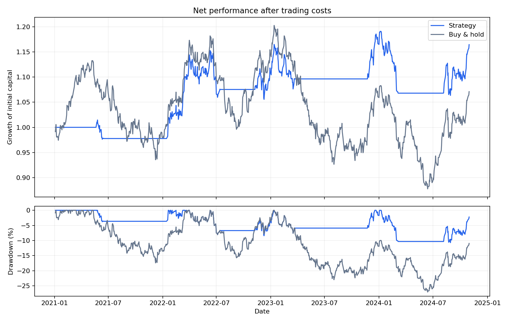

# Quant Backtest Lab

A small, auditable Python research project for **algorithmic trading and risk analysis**.
Compare moving-average crossover and mean-reversion strategies with buy-and-hold,
using historical adjusted closes, delayed execution, commission, and slippage.

This is an educational research tool. It does not place orders or demonstrate
that either strategy has a profitable edge.

## Quick start

Requires Python 3.10 or newer. Run commands from this repository's root.

```bash
python -m venv .venv
source .venv/bin/activate
# Windows PowerShell: .venv\Scripts\Activate.ps1
python -m pip install -e .

# Fully offline demo using included synthetic data
quant-backtest --csv data/synthetic.csv --strategy ma --fast 20 --slow 100

# Alternative strategy, separate output directory
quant-backtest --csv data/synthetic.csv --strategy mean-reversion \
  --window 20 --entry-z 1.5 --exit-z 0 --out results/mean-reversion

# Tests use the Python standard library
python -m unittest discover -s tests -v
```

To run from source without installing the package (dependencies must be available):

```bash
PYTHONPATH=src python -m quant_backtest.cli --csv data/synthetic.csv
PYTHONPATH=src python -m unittest discover -s tests -v
```

## Open without a server

Download `quant-backtest-demo.html` and double-click it to open in your browser.
This standalone demo uses bundled synthetic data and runs entirely in JavaScript;
no terminal, Python server, or internet connection is required. Its default
metrics were checked against the Python engine. Run `node tests/browser/offline-interaction.cjs` to exercise the standalone demo’s button and form interactions without a browser download. The risk-free input is a
percentage (enter `5` for 5%); changing it affects Sharpe and Sortino, but not
portfolio returns. Strategy windows and thresholds affect trading only when
they change entries or exits. The number of entries and exits is shown after
each run. Use the Python dashboard below
for your own CSV data and the original engine.

## Browser dashboard

Start the local dashboard from the repository root:

```bash
python -m pip install -e .
quant-backtest-web
# Without installing the package:
# PYTHONPATH=src python -m quant_backtest.web
```

Open **http://127.0.0.1:8000** in your browser. The dashboard runs the actual Python
engine, lets you change both strategies and trading costs, plots equity and
drawdown, compares risk metrics, and downloads the strategy ledger as CSV.
It starts with the included synthetic dataset. To use your own adjusted prices:

```bash
quant-backtest-web --csv path/to/prices.csv --port 8000
```

This server binds to localhost for local research. It is not a public production
hosting server. Live Yahoo fetching remains available through the CLI; the
browser uses the CSV selected when starting the server.

## Historical market data

```bash
python -m pip install -e '.[yahoo]'
quant-backtest --ticker SPY --start 2015-01-01 --end 2025-01-01 \
  --strategy ma --fast 50 --slow 200 --commission-bps 1 --slippage-bps 4
```

The Yahoo adapter uses `yfinance.download` with daily frequency and explicit
`auto_adjust=True`, `multi_level_index=False`. Start is inclusive; end is exclusive.
See the [official download reference](https://ranaroussi.github.io/yfinance/reference/api/yfinance.download.html).
The adapter is unit tested with a mocked provider; live downloads depend on
network access and provider availability. Errors or empty results are not replaced
with fabricated market data. Review Yahoo's terms and your rights before using or
redistributing downloaded prices. The MIT license covers this code, not third-party data.

Alternatively, provide a CSV:

```csv
Date,Close
2024-01-02,100.00
2024-01-03,101.50
2024-01-04,100.80
```

Use a single instrument with ascending, unique dates and finite positive closes.
Prices should be adjusted consistently for splits and distributions. Invalid rows
are rejected rather than silently forward-filled. `--start` and `--end` apply only
to Yahoo downloads; CSV inputs use all supplied rows. Annualization assumes one
observation per trading day, defaulting to 252 observations per year. Missing
sessions and exchange calendars are not inferred or validated.

## Strategy rules

| Strategy | Enter long | Exit to cash |
| --- | --- | --- |
| Moving average | Fast simple moving average exceeds slow simple moving average | Fast average is equal to or below slow average |
| Mean reversion | Rolling close-price z-score <= negative entry threshold | Z-score >= negative exit threshold |

Mean-reversion parameters must satisfy `0 <= exit_z < entry_z`. Rolling standard
deviation uses `ddof=1`; zero standard deviation produces no transition. Both
strategies start flat. All rolling windows are trailing, including the current
close. Warm-up observations stay in the evaluation window as cash: the benchmark
is invested during warm-up. This intentionally measures the complete run, not
only days where a strategy happens to be active.

## Execution and accounting

- A signal computed at close **t** executes at close **t+1**. The new position
  first earns the return from close **t+1** to close **t+2**. In code, interval
  exposure is `signal.shift(2)`. There is no same-close execution assumption.
- Positions are fully long or fully in cash, with fractional units and no leverage.
  Cash earns zero; the risk-free rate is a metric hurdle, not credited interest.
- One-way turnover is the absolute change in interval exposure. Entry and exit
  each incur `(commission_bps + slippage_bps) / 10_000` of equity.
- For each interval, `net_return = (1 - turnover * cost_rate) *
  (1 + position * asset_return) - 1`. Costs are deducted before the interval's
  market return. Both strategies and the benchmark use this convention.
- The benchmark buys at the first observed close, pays one entry cost, and earns
  every subsequent return. Strategy and benchmark have identical return dates.
- There is no final forced liquidation. End-of-sample equity is marked to market;
  any order that cannot execute within the sample has no effect.
- Drawdown peaks include initial capital, so a loss on the first interval counts.

This is a simplified proportional-cost close-price model. It excludes bid/ask
microstructure, market impact, liquidity limits, taxes, integer share constraints,
order rejections, borrowing, and explicit dividend cash flows. Adjusted-close
returns approximate reinvested distributions; adjusted prices are not literal
tradable execution quotes.

## Metrics

Let `r` be net interval returns, `N` annual periods, and
`h = (1 + annual_risk_free_rate) ** (1/N) - 1`.

| Metric | Convention |
| --- | --- |
| Total return | Final equity / initial equity - 1 |
| CAGR | (Final / initial) ** (N / observed intervals) - 1 |
| Annualized volatility | Sample standard deviation of r × sqrt(N) |
| Sharpe | Mean(r - h) / sample standard deviation(r - h) × sqrt(N) |
| Sortino | Mean(r - h) / sqrt(mean(min(r - h, 0)²)) × sqrt(N) |
| Maximum drawdown | Minimum equity / running peak - 1; reported as negative |
| Calmar | CAGR / absolute maximum drawdown |
| Exposure | Fraction of intervals invested |
| One-way trades | Number of entries plus exits; not completed round trips |

Sortino downside deviation uses **all intervals** in its denominator. Undefined
ratios are JSON `null`, not infinity. Short histories make annualized statistics
unstable. Annualization by observation count is an approximation, not a
calendar-time calculation.

## Outputs

Each run writes:

- `metrics.json`: net strategy and benchmark metrics.
- `backtest.csv` and `benchmark.csv`: interval prices, exposure, turnover, cost
  fractions, returns, equity, and drawdowns.
- `prices.csv`: normalized input data for reproduction.
- `run.json`: CLI arguments, date range, observation count, input SHA-256, and
  execution convention.
- `performance.png`: equity growth and drawdown comparison.

The committed `examples/` results use **synthetic data only** and are a software
demonstration, not evidence of historical investment performance. Regenerate:

```bash
quant-backtest --csv data/synthetic.csv --out examples
```



## Repository layout

```text
src/quant_backtest/
  data.py          # CSV validation and optional Yahoo downloader
  strategies.py    # Trailing-window long/flat signals
  engine.py        # Delayed execution and proportional trading costs
  metrics.py       # Risk and performance calculations
  cli.py           # Configurable runner, exports, and plotting
  web.py           # Local HTTP dashboard using the same Python engine
tests/             # Offline accounting, causality, validation, and CLI tests
data/              # Seeded synthetic fixture, safe to redistribute
examples/          # Demonstration outputs
.github/workflows/ # Python 3.10, 3.12, and 3.13 test matrix
```

## Make it credible to financial employers

A crossover implementation alone is a common beginner exercise. The useful part
of this project is accounting that can be audited and assumptions that can be
challenged. The tests check hand-calculated costs and metrics, delayed execution,
first-period drawdown, and whether changing future prices changes past signals.

Before claiming an investment result, pre-specify a strategy and benchmark,
reserve untouched chronological out-of-sample data, and evaluate once on that
holdout. Use a development period for any parameter selection. Report failed
variants, sensitivity to costs, market regimes, and the effects of survivorship
and selection bias. This project does **not** implement optimization, walk-forward
validation, statistical significance tests, or portfolio construction. Those are
useful future extensions; they should not be implied by a single backtest.

## Publish on GitHub

Create an empty repository named `quant-backtest-lab` on GitHub, then run:

```bash
git init
git add .
git commit -m "Initial release: transparent quantitative backtesting lab"
git branch -M main
git remote add origin https://github.com/YOUR_USERNAME/quant-backtest-lab.git
git push -u origin main
```

Replace `YOUR_USERNAME`. Select public visibility if you want an open-source
portfolio repository. The included MIT license permits reuse and modification.
Do not commit credentials or downloaded data without redistribution permission.

Suggested description: “Daily-bar quantitative research with moving-average and
mean-reversion strategies, delayed execution, transaction costs, and risk metrics.”
Suggested topics: `python`, `quantitative-finance`, `backtesting`,
`algorithmic-trading`, `risk-management`.

See [CONTRIBUTING.md](CONTRIBUTING.md) for contribution guidance.

### Interface decisions

The offline page uses a restrained research notebook layout, a clear hierarchy,
visible input labels, explicit calculation notes, and direct error text. Design
references: [Nielsen Norman Group on visual hierarchy](https://www.nngroup.com/articles/principles-visual-design/),
[GOV.UK on form labels](https://design-system.service.gov.uk/components/text-input/)
and [error messages](https://design-system.service.gov.uk/components/error-message/),
and [USWDS guidance on chart context and underlying data](https://designsystem.digital.gov/components/data-visualizations/).
